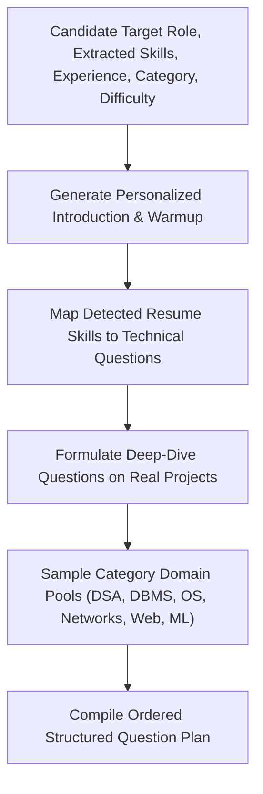

# AI Interview Engine & NLP Evaluation Methodology

## 1. Provider Abstraction Architecture

The AI Engine follows the **Strategy Design Pattern** via `BaseAIProvider`. It dynamically selects between:
1. **Google Gemini Provider** (`gemini-1.5-flash` with structured JSON schema output)
2. **OpenAI Provider** (`gpt-4o-mini` with JSON mode)
3. **Deterministic Fallback Provider** (Rule-based domain ontology with NLP heuristics)

---

## 2. Adaptive Question Planning Algorithm

---

## 3. Dynamic Follow-Up Question Trigger Heuristics

Follow-ups are dynamically injected after a candidate turn when:
1. **Brevity Trigger**: Word count $W < 7$ words $\rightarrow$ probes for concrete explanation or scenario.
2. **Keyword Inquiry**: Mention of pivotal keywords (e.g., `Polymorphism`, `Hash Map`, `B-Tree`, `ACID`, `Microservices`) $\rightarrow$ deep-dives into trade-offs, internal mechanics, or concurrency.
3. **Edge-Case & Scale Probing**: For comprehensive answers ($W > 25$), dynamically prompts for failure modes, scalability bottlenecks, and trade-offs.

---

## 4. Multi-Dimensional Scoring Mathematical Model

Each candidate turn is scored on six dimensions $\in [0, 100]$:

### 1. Relevance Score ($S_{rel}$)
Calculates token overlap between the question prompt's content words $Q_{words}$ and candidate response $A_{words}$:
$$S_{rel} = \min\left(100, 70 \cdot \frac{|Q_{words} \cap A_{words}|}{|Q_{words}|} + 30 \cdot \frac{\min(|A_{words}|, 50)}{50}\right)$$

### 2. Correctness Score ($S_{cor}$)
Evaluates coverage of expected rubric concepts $C_{expected}$:
$$S_{cor} = \min\left(100, 80 \cdot \frac{|C_{matched}|}{|C_{expected}|} + 20\right)$$

### 3. Technical Depth ($S_{dep}$)
Measures density of domain-specific architectural and algorithmic vocabulary:
$$S_{dep} = \min\left(100, 12 \cdot N_{tech\_terms} + 40 \cdot \frac{\min(|A_{words}|, 80)}{80}\right)$$

### 4. Clarity & Structure ($S_{cla}$)
Evaluates structural coherence (transitions like *first, for example, however, in conclusion*):
$$S_{cla} = \text{Base}_{structure} + 30 \cdot \frac{\min(|A_{words}|, 60)}{60}$$

### 5. Completeness ($S_{com}$)
Rewards depth of explanation alongside concept coverage:
$$S_{com} = 60 \cdot \frac{\min(|A_{words}|, 70)}{70} + 10 \cdot |C_{matched}|$$

### 6. Confidence & Delivery ($S_{con}$)
Penalizes hesitation markers / fillers (*um, uh, like, you know*) while rewarding steady articulation:
$$S_{con} = \max\left(35, 85 - 5 \cdot N_{fillers} + 15 \cdot \frac{\min(|A_{words}|, 50)}{50}\right)$$

---

## 5. Executive Hiring Verdict Mapping

Overall composite score $S_{overall}$:
- **$85 \le S_{overall} \le 100$**: **Strong Hire**
- **$72 \le S_{overall} < 85$**: **Hire**
- **$58 \le S_{overall} < 72$**: **Leaning Hire**
- **$45 \le S_{overall} < 58$**: **Needs Improvement**
- **$S_{overall} < 45$**: **Reject**
