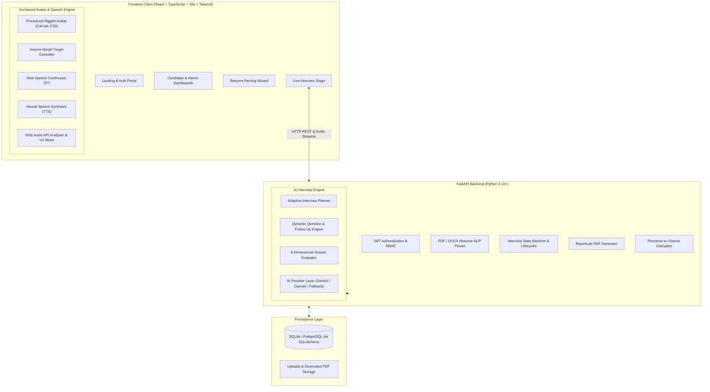

# System Architecture & Technical Design

## 1. Executive Summary

The **AI-Powered Humanoid Virtual Interviewer** is an end-to-end autonomous intelligent candidate assessment platform. It combines Human-Computer Interaction (HCI), real-time speech processing, continuous Natural Language Processing (NLP), and multi-criteria evaluation engines to simulate realistic recruitment interviews.

---

## 2. High-Level Architectural Diagram

---

## 3. Core Subsystems

### A. Procedural Humanoid Avatar & Lip-Sync Subsystem (Member 4)
- **Canvas Rigging**: The avatar is rendered procedurally on an HTML5 2D Canvas with sub-pixel rendering. Features structured human facial anatomy (eyeballs, hazel iris, specular reflections, blinking eyelids, eyebrows with emotional tilt, nose, cheek warmth, hair layers, neck, navy suit, and tie).
- **State Machine**:
  - `IDLE`: Sinusoidal natural breathing ($f = 0.25\text{ Hz}$), randomized eye blinks every 2.5–6.0 seconds.
  - `TALKING`: Active mouth visemes morphing smoothly via linear interpolation (lerp $\alpha = 0.35$), subtle speech head bobbing.
  - `LISTENING`: Attentive head tilt, micro-nodding reacting directly to candidate microphone amplitude extracted via Web Audio `AnalyserNode`.
  - `THINKING`: Slight upward eye gaze tracking, pulsating ethereal AI halo ($f = 0.65\text{ Hz}$).
- **Viseme Taxonomy**: Maps English phonemes to visual mouth shapes: `AA`, `EE`, `IH`, `OH`, `OU`, `MBP`, `FV`, `TH`, `CDGK`, and `REST`.

### B. Dual-Pipeline Speech System (Member 4)
- **Speech-to-Text (STT)**: Continuous browser `webkitSpeechRecognition` with interim live transcripts, silence detection, confidence scores, and instant manual text edit override.
- **Text-to-Speech (TTS)**: Web Speech Synthesis API utilizing Neural English voices with word-boundary event listeners synchronized with viseme timestamps.

### C. Multi-Criteria AI Evaluation Engine (Member 3)
Evaluates candidate responses across six independent dimensions ($S \in [0, 100]$):
1. **Relevance ($S_{rel}$)**: Semantic alignment with question keywords and prompt requirements.
2. **Correctness ($S_{cor}$)**: Technical validity and presence of key algorithmic/architectural concepts.
3. **Technical Depth ($S_{dep}$)**: Delving into underlying mechanics, memory, complexities, vs keyword dropping.
4. **Clarity & Structure ($S_{cla}$)**: Logical coherence, transitional phrasing, STAR framework.
5. **Completeness ($S_{com}$)**: Consideration of edge cases, trade-offs, and examples.
6. **Confidence & Delivery ($S_{con}$)**: Speech cadence, articulation, and penalty for hesitation markers.

Composite Answer Score:
$$S_{composite} = 0.20 S_{rel} + 0.25 S_{cor} + 0.20 S_{dep} + 0.15 S_{cla} + 0.10 S_{com} + 0.10 S_{con}$$

### D. Resume NLP Parser (Member 3)
- Extracts raw text from `.pdf` (using `pypdf`/`pdfplumber`), `.docx` (using `python-docx`), and `.txt`.
- Regex/keyword extraction across 60+ technical skills, academic degrees, project headings, and certifications.
- Automatically maps detected skills to interview domains and injects resume project deep-dive questions.

### E. Backend API & Relational Database (Member 2)
- Built on **FastAPI** with asynchronous request routing, Pydantic validation schemas, and SQLAlchemy ORM.
- Secure **bcrypt** password hashing and **JWT** Bearer tokens with Role-Based Access Control (`candidate`, `admin`).
- Seed accounts generated automatically on startup.

### F. Frontend User Interface (Member 1)
- Built on **React 18 + TypeScript + Vite + Tailwind CSS + Lucide Icons + Recharts**.
- Fully responsive 3-column interview stage, candidate analytics dashboard, and admin telemetry portal.
