# Database Architecture & Entity Relationship Schema

## 1. Relational Database Overview

The system utilizes **SQLAlchemy ORM** with native support for both **SQLite** (for zero-configuration local execution) and **PostgreSQL** (for production enterprise deployments).

---

## 2. Entity-Relationship (ER) Diagram

```mermaid
erDiagram
    USERS ||--o| CANDIDATE_PROFILES : "has"
    USERS ||--o{ RESUMES : "uploads"
    USERS ||--o{ INTERVIEWS : "takes"
    USERS ||--o{ SYSTEM_LOGS : "triggers"
    
    RESUMES ||--o{ INTERVIEWS : "configures"
    
    INTERVIEWS ||--|{ INTERVIEW_QUESTIONS : "contains"
    INTERVIEWS ||--o{ CANDIDATE_ANSWERS : "records"
    INTERVIEWS ||--o| INTERVIEW_REPORTS : "evaluates_to"
    
    INTERVIEW_QUESTIONS ||--o| CANDIDATE_ANSWERS : "receives"
    CANDIDATE_ANSWERS ||--o| ANSWER_EVALUATIONS : "scores"

    USERS {
        int id PK
        string email UK
        string hashed_password
        string full_name
        string role
        boolean is_active
        datetime created_at
        datetime updated_at
    }

    CANDIDATE_PROFILES {
        int id PK
        int user_id FK
        string target_role
        string experience_level
        json skills
        text bio
        string github_url
        string linkedin_url
        datetime updated_at
    }

    RESUMES {
        int id PK
        int user_id FK
        string filename
        string file_path
        int file_size_bytes
        text extracted_text
        json parsed_skills
        json parsed_projects
        json parsed_education
        json parsed_experience
        datetime uploaded_at
    }

    INTERVIEWS {
        int id PK
        int user_id FK
        int resume_id FK
        string title
        string target_role
        string mode
        string category
        string difficulty
        int total_questions
        int current_index
        string status
        float overall_score
        int duration_seconds
        datetime created_at
        datetime completed_at
    }

    INTERVIEW_QUESTIONS {
        int id PK
        int interview_id FK
        text question_text
        string question_type
        string category
        string difficulty
        int order_index
        json expected_concepts
        boolean is_follow_up
        int parent_question_id FK
    }

    CANDIDATE_ANSWERS {
        int id PK
        int interview_id FK
        int question_id FK
        text transcript_text
        float audio_duration_seconds
        datetime answered_at
    }

    ANSWER_EVALUATIONS {
        int id PK
        int answer_id FK
        float score
        float relevance_score
        float correctness_score
        float depth_score
        float clarity_score
        float completeness_score
        float confidence_score
        text feedback
        json strengths
        json weaknesses
        json missing_concepts
        json suggestions
        datetime evaluated_at
    }

    INTERVIEW_REPORTS {
        int id PK
        int interview_id FK
        float overall_score
        float technical_score
        float communication_score
        float problem_solving_score
        float confidence_score
        string verdict
        text executive_summary
        json strengths
        json weaknesses
        json skill_gaps
        json recommendations
        json question_breakdown
        string pdf_report_path
        datetime generated_at
    }

    SYSTEM_LOGS {
        int id PK
        int user_id FK
        string action
        string level
        json details
        string ip_address
        datetime timestamp
    }
```

---

## 3. Database Indices & Optimization
- Unique indexes on `users.email` and `system_settings.key`.
- Foreign key cascading deletes configured on `candidate_profiles`, `resumes`, `interviews`, `interview_questions`, `candidate_answers`, and `answer_evaluations`.
- Indexed lookup fields: `user_id`, `interview_id`, `question_id`, `answer_id`.
